# 🛡️ Production-Grade API Gateway

A robust, high-performance edge API Gateway router designed to manage downstream microservice communications. Features Redis-backed sliding-window rate limiting, JWT/API token authorization checks, and custom-implemented Circuit Breakers to prevent cascading microservice failures.

---

## 🏗️ Architectural Topology

```mermaid
graph TD
    Client[Client Browser / Mobile] -->|Requests| Gateway[API Gateway :8080]
    Gateway -->|Redis Check| Redis[(Redis sorted sets)]
    Gateway -->|Forward to Auth| AuthSvc[Auth Service :3001]
    Gateway -->|Forward to Billing| BillSvc[Billing Service :3002]
    Gateway -->|Forward to Users| UserSvc[User Service :3003]

    style Gateway fill:#0e0e17,stroke:#63b3ed,stroke-width:2px;
    style Redis fill:#0e0e17,stroke:#fc8181,stroke-width:2px;
```



---

## ⚡ Core Systems Implementations

### 1. Redis-Backed Sliding-Window Rate Limiter
Uses Redis Sorted Sets (zsets) to track client IP address request frequencies. By executing atomic pipelines (`multi` commands), it prevents concurrent race conditions and cleans up outdated metrics automatically:
*   **Time-window sliding calculation**: Removes values older than `RATE_LIMIT_WINDOW_MS` using `zremrangebyscore` and registers the current stamp using `zadd`.
*   **Performance**: Completes checks in under `1.5ms` under high concurrency.
*   **Fallback Strategy**: Gracefully fails-open (allowing traffic) if the Redis broker connection drops to preserve user experience.

### 2. Custom SRE Circuit Breaker
Every downstream microservice is wrapped inside a dedicated `CircuitBreaker` worker state monitor. It protects system uptime using a finite-state machine:

```
        +---------+       Failure > Threshold       +---------+
        |         | ------------------------------> |         |
        | CLOSED  |                                 |  OPEN   |
        |         | <------------------------------ |         |
        +---------+       Successful test passes    +---------+
             ^                                           |
             |                                           | Cooldown expires
             |            Failed test triggers           |
             +-------------------------------------------+
                             (HALF-OPEN)
```

*   **CLOSED**: Normal operations. Downstream requests are proxied directly.
*   **OPEN**: Failure threshold met (e.g., 3 consecutive 500 errors or timeouts). Downstream requests are blocked and fast-failed immediately with a `503 Service Unavailable` response to prevent node overload.
*   **HALF-OPEN**: Tripped after a `10-second` cooldown. Allows a single test request through. If it succeeds, the circuit closes; if it fails, it trips back to `OPEN` immediately.

### 3. Edge Authentication & Headers Propagation
Authenticates bearer tokens at the edge proxy, mapping security contexts to downstream request headers (`x-user-role`, `x-authenticated-client`) to decouple microservice authentication concerns.

---

## 🛠️ Configuration & Environment Variables

Create a `.env` file in the root directory to configure the gateway settings:

| Variable | Description | Default |
| :--- | :--- | :--- |
| `PORT` | Listening port for the API Gateway | `8080` |
| `REDIS_URL` | Redis broker connection URI | `redis://localhost:6379` |
| `RATE_LIMIT_WINDOW_MS` | Sliding window range (in milliseconds) | `60000` |
| `RATE_LIMIT_MAX_REQUESTS`| Max allowed requests inside the window | `100` |
| `AUTH_SERVICE_URL` | Destination URL for Auth Service | `http://localhost:3001` |
| `BILLING_SERVICE_URL` | Destination URL for Billing Service | `http://localhost:3002` |
| `USERS_SERVICE_URL` | Destination URL for Users Service | `http://localhost:3003` |

---

## 🚀 Running the API Gateway

### Prerequisites
*   **Node.js** (v18 or higher)
*   **Redis Server** (optional, fallback in-memory checks run if down)

### Installation
```bash
# Clone the repository
git clone https://github.com/harsharajkumar-273/API-gateway.git
cd API-gateway

# Install production dependencies
npm install
```

### Starting the Server
```bash
# Run in development/production mode
npm start
```

---

## 📊 Live Metrics & Health Checks
The gateway exposes a dedicated `/health` endpoint containing uptime and circuit breaker state mappings:
```json
{
  "status": "healthy",
  "timestamp": "2026-07-06T14:20:29Z",
  "uptime": 142.45,
  "services": {
    "auth": "CLOSED",
    "billing": "CLOSED",
    "users": "CLOSED"
  }
}
```

---

## 📜 License
Distributed under the MIT License. See [LICENSE](LICENSE) for more details.
